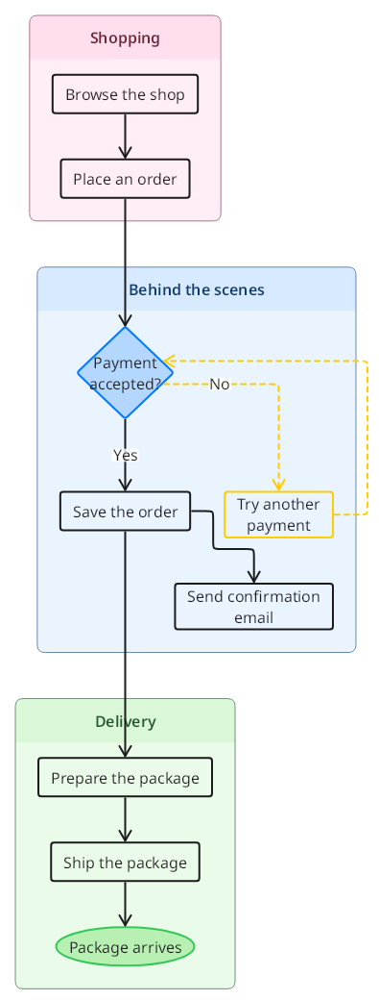

# TextGraph for Markdown Preview

**Write the flow. See the diagram.**

Turn a few lines in your Markdown into a diagram people can follow, right beside your text in VS Code.

[Install TextGraph](https://marketplace.visualstudio.com/items?itemName=drawmotive.textgraph-markdown) · [Try this diagram](https://textgraph.dev/playground?d=1.eJxNj71uwzAQg_d7Co4y0LyAhmToz1gE6NRRkC71obIkSHILp-i7F5KduNuB4H0k1RizXGOoxg9EdmT7GeeqUpbJ5GXQeNwk_BAQs-OMwxHJLBOHSrhdOByVM2Vkh2-Tg4SPYXNrvMYHZK55oV-iy-wv4n37UWW2lksZNF52tQeVUVLLcezlizM7Angy4htij1x9Gu9c_qvducnUW2icvbG8VrpZlRMzxeDQorFPPhtxJ2pojbcWsH51qsZzh2e2LKnSvaBi7yUVXmH7sqf7gj9nDXvi) · [Open the example Markdown](examples/online-order.md)


## Try it with your own words

1. Install **TextGraph for Markdown Preview** and open [online-order.md](examples/online-order.md) in a trusted workspace.
2. Run **Markdown: Open Preview to the Side** (`Ctrl+K V`, or `Cmd+K V` on macOS).
3. Change **Delivered** to **At your door**. The diagram updates as you type, including unsaved edits.

Your diagram stays with your documentation as readable text.

<!-- public-preview:start -->

````markdown
```textgraph
(horizontal)

checkout(primary): Checkout {
  order -> payment
  payment ->(dashed warning) order : No, retry
}

fulfillment(success): Fulfillment {
  ship -> delivered
  email
}

payment -> ship : Yes
payment -> email : Yes

order: Place order
payment(diamond fill primary): Paid?
ship: Ship order
email: Email receipt
delivered(ellipse fill success): Delivered
```
````



[Open the full diagram](media/online-order.png) · [Copy the source](examples/online-order.textgraph) · [Try this diagram](https://textgraph.dev/playground?d=1.eJxNj71uwzAQg_d7Co4y0LyAhmToz1gE6NRRkC71obIkSHILp-i7F5KduNuB4H0k1RizXGOoxg9EdmT7GeeqUpbJ5GXQeNwk_BAQs-OMwxHJLBOHSrhdOByVM2Vkh2-Tg4SPYXNrvMYHZK55oV-iy-wv4n37UWW2lksZNF52tQeVUVLLcezlizM7Angy4htij1x9Gu9c_qvducnUW2icvbG8VrpZlRMzxeDQorFPPhtxJ2pojbcWsH51qsZzh2e2LKnSvaBi7yUVXmH7sqf7gj9nDXvi)

<!-- public-preview:end -->

For Chinese, Japanese, and color emoji, see the [packaged font examples](https://github.com/drawmotive/textgraph/tree/main/language-packs#language-coverage).

Connections inside a group introduce its local nodes and may style endpoints
inline. Keep standalone node labels or styles at the root, in any order.
Root short names find a node when its name is unique. The same name in two
groups creates two nodes: `Review { done }` and `Delivery { done }` need
`Review.done` or `Delivery.done` when referenced at the root. Short names
inside each group are local. Group names follow the same rule, and nested
names can use a unique suffix such as `Backend.payment`. Qualified
connection endpoints refer to existing objects without changing containment.

[Example with repeated node names](examples/repeated-names.textgraph)

Renders locally, without an account or API key. Requires VS Code 1.101 or newer and a trusted workspace; the first preview takes a few seconds to initialize.

Want to move shapes and edit on a canvas? Try the downloadable editable example in [DrawMotive for VS Code](https://github.com/drawmotive/vscode-drawmotive). This Markdown extension previews TextGraph; it does not transfer a source block into the visual editor.

[Report an issue](https://github.com/drawmotive/textgraph/issues) · [Development and support](docs/development.md) · [Project](https://github.com/drawmotive/markdown-textgraph)
