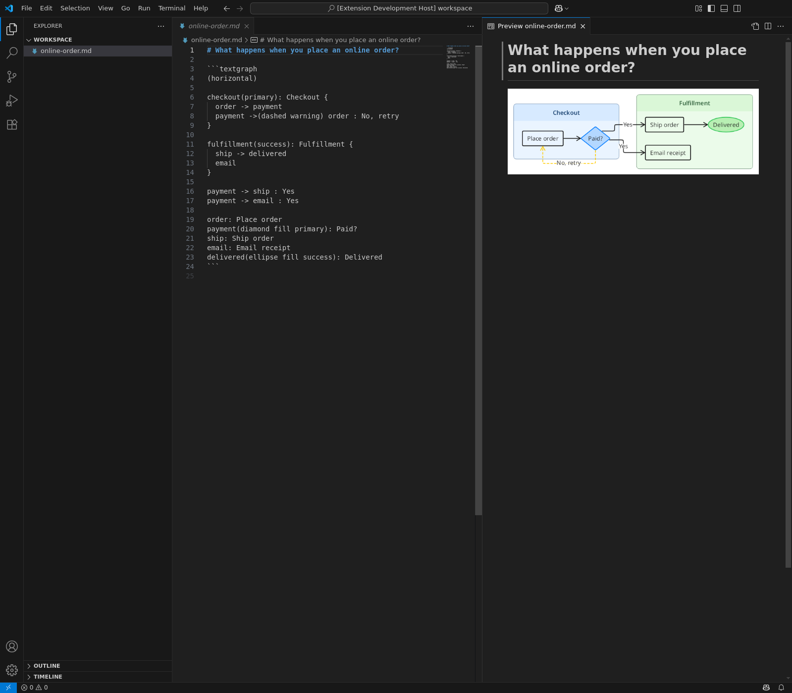

# TextGraph for Markdown Preview

**Write the flow. See the diagram.**

Turn a few lines in your Markdown into a diagram people can follow, right beside your text in VS Code.

[Install TextGraph](https://marketplace.visualstudio.com/items?itemName=drawmotive.textgraph-markdown) · [Try this diagram](https://textgraph.dev/playground#source=shopping%28info%29%3A%20Shopping%20%7B%0A%20%20browse%20-%3E%20checkout%0A%7D%0A%0Aprocessing%28primary%29%3A%20Behind%20the%20scenes%20%7B%0A%20%20payment%20-%3E%20saved%20%3A%20Yes%0A%20%20payment%20-%3E%28dashed%20warning%29%20retry%20%3A%20No%0A%20%20retry%20-%3E%28dashed%20warning%29%20payment%0A%20%20saved%20-%3E%20email%0A%7D%0A%0Adelivery%28success%29%3A%20Delivery%20%7B%0A%20%20pack%20-%3E%20ship%20-%3E%20arrived%0A%7D%0A%0Acheckout%20-%3E%20payment%0Asaved%20-%3E%20pack%0A%0Abrowse%3A%20Browse%20the%20shop%0Acheckout%3A%20Place%20an%20order%0Apayment%28diamond%20fill%20primary%29%3A%20Payment%5Cnaccepted%3F%0Aretry%28warning%29%3A%20Try%20another%5Cnpayment%0Asaved%3A%20Save%20the%20order%0Aemail%3A%20Send%20confirmation%5Cnemail%0Apack%3A%20Prepare%20the%20package%0Aship%3A%20Ship%20the%20package%0Aarrived%28ellipse%20fill%20success%29%3A%20Package%20arrives%0A) · [Open the example Markdown](examples/online-order.md)



## Try it with your own words

1. Install **TextGraph for Markdown Preview** and open [online-order.md](examples/online-order.md) in a trusted workspace.
2. Run **Markdown: Open Preview to the Side** (`Ctrl+K V`, or `Cmd+K V` on macOS).
3. Change **Package arrives** to **Delivered**. The diagram updates as you type, including unsaved edits.

Your diagram stays with your documentation as readable text.

<details>
<summary>Copy the complete Markdown example</summary>

````markdown
# What happens when you place an online order?

```textgraph
shopping(info): Shopping {
  browse -> checkout
}

processing(primary): Behind the scenes {
  payment -> saved : Yes
  payment ->(dashed warning) retry : No
  retry ->(dashed warning) payment
  saved -> email
}

delivery(success): Delivery {
  pack -> ship -> arrived
}

checkout -> payment
saved -> pack

browse: Browse the shop
checkout: Place an order
payment(diamond fill primary): Payment\naccepted?
retry(warning): Try another\npayment
saved: Save the order
email: Send confirmation\nemail
pack: Prepare the package
ship: Ship the package
arrived(ellipse fill success): Package arrives
```
````

[TextGraph source](examples/online-order.textgraph)

</details>

Connections inside a group introduce its members and may style endpoints
inline. Keep connections between groups and separate node labels or styles
at the root. Each name refers to the same node throughout the diagram. A node
belongs to one group; use distinct names when two nodes share a visible label.

Renders locally, without an account or API key. Requires VS Code 1.101 or newer and a trusted workspace; the first preview takes a few seconds to initialize.

Want to move shapes and edit on a canvas? Open the same diagram in [DrawMotive for VS Code](https://github.com/drawmotive/vscode-drawmotive).

[Report an issue](https://github.com/drawmotive/textgraph/issues) · [Development and support](docs/development.md) · [Project](https://github.com/drawmotive/markdown-textgraph)
